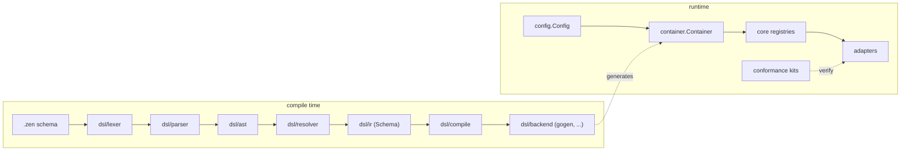

# Architecture

Contributor overview of how zever fits together: the `.zen` schema
compiler, the runtime container, the adapter registries, and the
conformance kits that keep adapters interchangeable.

For the authoritative per-layer details, see `CLAUDE.md` (Architecture),
`AGENTS.md` (Architecture ownership), `config/README.md`,
`container/README.md`, and `docs/writing-a-plugin.md`
(site source: `docs/src/content/docs/guides/extend/write-a-plugin.mdx`).

## Big picture

No external images: the diagram above is the whole picture.

## Compiler pipeline (`dsl/`)

Compile-time only. Runtime packages must not import `dsl/`
(see `CLAUDE.md`, Schema compiler).

Stages (`dsl/parser/parser.go:1`, `dsl/compile/compile.go:40`):

1. `dsl/lexer` — bytes to tokens. Never panics; fuzz-tested.
2. `dsl/parser` — token stream to `dsl/ast` (`parser.New(file, src).ParseFile()`).
   Best-effort with per-declaration error recovery plus a depth guard
   (`dsl/parser/parser_attribute.go:169`, `maxValueDepth = 200`).
   Never panics; always returns a non-nil file plus `diag` diagnostics.
3. `dsl/resolver` — multi-pass `[]*ast.File` to `*ir.Schema`
   (`resolver.Resolve(files)`), keep-going diagnostics.
4. `dsl/ir` — resolved schema plus the gRPC-canonical `ErrorCode` table.
5. `dsl/compile` — filename-sorted parse, resolve, then
   `backend.Backend.Generate` (`Compile(files, backends...)`,
   `CompileContext` for cancellation).
6. `dsl/backend` — code generators (for example `gogen`).
   `dsl/format` (idempotent formatter) and `dsl/breaking`
   (old-vs-new compatibility diff) sit alongside.

Canonical fixture: `dsl/compile/testdata/app.zen` — two entities,
two services, `has_many`/`belongs_to` relation pair. Committed-output
integration tests regenerate with
`go test ./dsl/compile/ -run <TestName> -update`.

## Configuration (`config/`)

Env-only, strictly-typed: `defaults < .env < .env.local < process env`
(`config/default.go:50`).

- `config.Default()` — zero-infrastructure adapters (memory, local,
  sqlite, log, noop) so tests run with no external services. Ships one
  deterministic dev-only crypto key, never for production.
- `config.FromEnv()` — reads `.env`, then `.env.local`, and overlays the
  real process environment. `config.Resolve(env)` applies that map over the
  defaults and validates fail-closed. `config.LoadEnv(files...)` parses
  explicit dotenv files only. There are no service config files: a legacy
  `zever.yaml`/`.yml`/`.json` in the working directory is never read.
- Env vars — no prefix. The default instance is `<SERVICE>_<FIELD>` (for
  example `DB_MAXCONNS`), a named instance `<SERVICE>__<NAME>__<FIELD>`.
  Matching ignores case and `_`; unknown vars are ignored, unknown keys
  under a wired service prefix and parse failures on resolved fields
  error out.
- Never log raw option maps; redact via `config/redact.go:257`
  (`Redact` / `RedactedServices`).

## Container (`container/`)

One process-wide, lazily resolved instance holder
(`container/container.go:125`, `container.New(cfg)`; nil cfg valid).

- Each service resolves on first accessor call (`c.DB()`, `c.Cache()`,
  ...) and caches the result; on error the cache clears so the next
  call retries (`container/README.md:41`).
- The container wires no adapters itself. Every adapter registers
  caller-side via its own module's `Register()`
  (`container/README.md:20`, `container/adapters.go:59`).
- `Job()` has no adapter: it builds a dispatcher over the resolved
  `Queue`. `Scheduler()` shares `Cache`/`Queue` (resolving them as a
  side effect).
- `Close(ctx)` closes only resolved services in dependency order,
  probing `Close(ctx)` / `Close()` / `Stop()` / `Shutdown(ctx)`
  (`container/close.go:27`). Pointer-identity dedup, `errors.Join`,
  panics become `ClosePanicError`, timeouts `CloseTimeoutError`
  (value types). Per-service bound: `DefaultCloseTimeout`
  (`container/close.go:18`).
- Tests enforce `goleak.VerifyTestMain`
  (`container/goleak_test.go:10`); keep timeout tests short.

## Registries (`core/<battery>` + `adapters/<battery>/<name>`)

Each battery is one small interface plus a registry
(`core/cache/cache.go:34`, `core/queue/queue.go:94`):

- `core/cache/cache.go:48` — `Register(adapter, factory)` associates
  an adapter name with a factory; `core/cache/cache.go:58`
  (`Open`) resolves it. `RegisteredAdapters()` lists sorted names
  backed by `shared/registry` (`shared/registry/registry.go:30`,
  `shared/registry/registry.go:105`).
- One Go module per adapter (`adapters/<battery>/<name>`) with a
  `Register()` call wiring itself into its `core` registry. The
  container is the sole resolver.
- Rule: never add methods to a public interface (breaks every
  downstream implementer); prefer a new interface
  (`orm/dialect/dialect.go:52` shows the fail-closed counterpart:
  unsupported dialect features return `ErrUnsupportedByDialect`,
  never wrong SQL).

## Conformance kits (`core/*/*test`)

Every swappable battery ships a kit that every adapter must pass:

- `core/cache/cachetest/conformance.go:48`
  (`Conformance(t, factory)`), `core/queue/queuetest/conformance.go:47`.
- CI runs in-kit suites plus all cross-adapter `-run Conformance`
  invocations (`.github/workflows/ci.yml:207`, `conformance` job).
  Current standing (honest counts) lives in `STABILITY.md`.
- New batteries must ship a kit to be accepted; see the plugin guide
  (`docs/src/content/docs/guides/extend/write-a-plugin.mdx`)
  and the `API Compatibility` / `apidiff` gate (`Makefile:91`,
  `make apidiff`).

## Cross-cutting conventions

- Errors: `<package>: <message>` prefix, package-level `ErrXxx`
  sentinels, `%w` wrapping, `errors.Is`/`As` branching
  (`docs/src/content/docs/reference/errors.mdx`, `make err-lint`
  in `Makefile:87`).
- Tests deterministic: no `time.Sleep` sync, no network, no unseeded
  randomness, no timing assertions
  (`.github/CONTRIBUTING-testing.md`).
- Releases: lockstep, one version, per-module tags `<path>/vX.Y.Z`
  via `tools/tag-release.sh`; `make version-check` (`Makefile:103`)
  keeps pins together.
